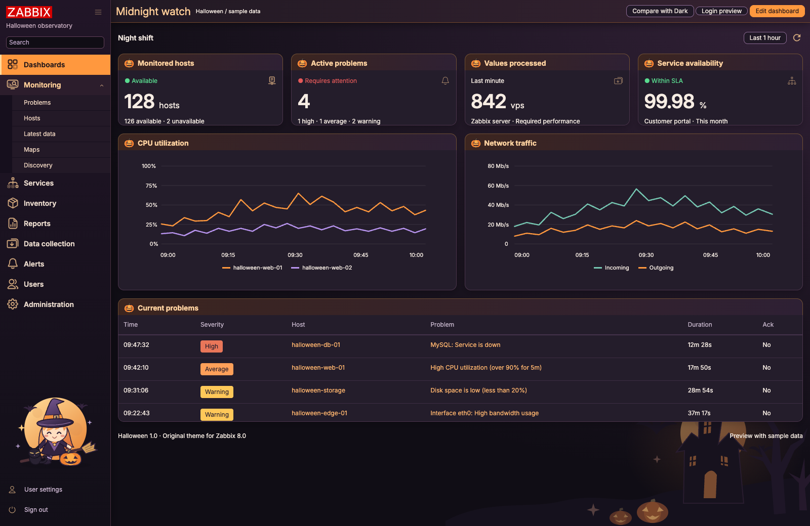

# Halloween for Zabbix

A dark Halloween theme with pumpkin-orange controls, violet panels, bats, a haunted backdrop, and original witch, cat, and jack-o’-lantern artwork.

**Experimental · AI-generated customizations · Zabbix 8.0.0rc3 · GNU AGPL v3**

> [!WARNING]
> **NOT FOR PRODUCTION — LABS AND DEMONSTRATIONS ONLY.** Do not deploy this experimental theme on production, business-critical, or safety-critical monitoring systems.
> The installer modifies the shared Zabbix file `include/classes/core/APP.php`; a PHP error can disrupt the web interface and API for all users, including users who select another theme. CSS changes can obscure or misrepresent information on screen. Passing tests does not establish production suitability. Read [the disclaimer](DISCLAIMER.md) and [installation guide](docs/INSTALLATION.md).

> [!IMPORTANT]
> **AI-GENERATED PROJECT CUSTOMIZATIONS.** The project-specific theme customizations, installer, and documentation were generated with AI assistance in OpenAI Codex using **GPT-6 Astra (`gpt-6-astra`)**. Bundled Zabbix source and third-party fonts retain their original authorship and licenses.
> AI output may contain defects, insecure assumptions, or incomplete instructions. Review the source and test only in an isolated, disposable environment. No independent security audit or production certification is claimed. Naming these tools does not imply endorsement by OpenAI or Zabbix SIA.



## Features

- Complete theme compiled from the pinned Zabbix Dark Sass sources.
- Local, editable SVG artwork; no JavaScript installed in Zabbix and no added external asset requests.
- Install, preview, repair after frontend upgrades, update assets, and uninstall.
- Preserves supported existing custom-theme registrations.
- An interactive offline preview using reconstructed markup and sample data.
- Full theme source, provenance, license notices, and automated checks.

## Compatibility

| Item | Status |
| --- | --- |
| Source baseline | Zabbix 8.0.0rc3, commit `00c492823ad396e2de596f2fd07a9ffdfbf78e41` |
| Other 8.0 builds | Accepted by the installer, but compatibility must be tested |
| Installer | Python 3.8 or newer; PHP CLI is used for syntax checks when available |
| Database and services | Not changed by the installer |
| Intended use | Isolated labs and demonstrations; not for production |
| Live production validation | Not performed; automated checks are not a production certification |

Frontend upgrades can replace theme registration. Repair restores registration in the current frontend; it does not rebuild the stylesheet for a new Zabbix version. Classic server-rendered graphs retain their existing/fallback palette. See [validation details](VALIDATION.txt).

## Install

The examples use `/usr/share/zabbix/ui`, the frontend directory for official Zabbix 8.0 packages on RHEL and its derivatives. See the [official frontend documentation](https://www.zabbix.com/documentation/8.0/en/manual/installation/frontend). For a custom installation, pass the actual frontend directory containing `assets/` and `include/`.

Download and extract the release package into an isolated lab, then run from its directory. Keep a recovery route outside the web interface and retain the backups:

```sh
python3 install.py /usr/share/zabbix/ui --check
python3 install.py /usr/share/zabbix/ui --install
```

Use an account with permission to modify the frontend and create backups. Select **User settings → Profile → Theme → Halloween**, then **Update** and reload. To style the login page, an administrator can also select Halloween as the frontend default under **Administration → General → GUI**.

The installer backs up `APP.php` outside the web root under `/var/backups/zabbix-halloween/`, registers Halloween, and adds one CSS file and three SVG files. Unknown PHP customizations and edited theme assets stop automatic changes. Keep the backup directory for later repair and uninstall.

If PHP OPcache timestamp validation is disabled, reload the PHP runtime serving the frontend after registration changes. Hard-refresh the browser if it still shows cached styles.

### Repair after a frontend upgrade

Use this package’s installer and the original backup directory:

```sh
python3 install.py /usr/share/zabbix/ui --repair --check
python3 install.py /usr/share/zabbix/ui --repair
```

Repair preserves the current frontend file as the new uninstall baseline and archives the previous installation record. Do not restore an old complete `APP.php` over an upgraded frontend.

### Uninstall

First select another installed theme in affected user profiles and the frontend default. The installer cannot inspect or change saved database preferences. Then run:

```sh
python3 install.py /usr/share/zabbix/ui --uninstall --check
python3 install.py /usr/share/zabbix/ui --uninstall
```

Removal checks the recorded files, preserves unknown edits, and retains recovery records. It also supports a frontend upgrade that already removed Halloween registration. Read [the complete installation, update, and removal guide](docs/INSTALLATION.md) for custom backup locations and manual merges.

## Preview and development

Open `preview/index.html` for the sample dashboard and **Compare with Dark** control. Open `preview/login.html` for the login design; it does not send or store credentials. These are illustrative previews, not screenshots of a live monitoring system.

```sh
python3 -m venv .venv
. .venv/bin/activate
pip install -r requirements-test.txt
python3 build.py
python3 tests/check_theme.py
python3 -m unittest discover -s tests -p 'test_*.py' -v
python3 scripts/package_release.py
```

Edit the palette and decorations in `source/`, and the original artwork in `theme/assets/styles/halloween/`. Installation of the precompiled release does not require Sass tooling. The release script creates a ZIP and SHA-256 checksum in `dist/`.

## License and independence

This package is licensed under the **GNU Affero General Public License, version 3 only**, with separately licensed Inter fonts under the SIL Open Font License 1.1. You may use, modify, and redistribute it, including commercially, subject to the applicable license terms. It is not a public-domain or unrestricted MIT-licensed package: it contains Zabbix-derived code. Preserve notices and comply with applicable source-availability obligations when distributing or offering modified covered software over a network.

See [LICENSE](LICENSE), [NOTICE.md](NOTICE.md), and [the disclaimer](DISCLAIMER.md). The software is provided **“AS IS,” without warranty**, with liability exclusions only to the extent permitted by applicable law. No support, service-level agreement, or fitness for production is promised.

This is an independent community theme. It is not affiliated with, endorsed by, or supported by Zabbix SIA. Zabbix is a trademark of its respective owner. The artwork uses generic Halloween motifs and does not represent a licensed entertainment franchise.

Contributions: [CONTRIBUTING.md](CONTRIBUTING.md) · Security: [SECURITY.md](SECURITY.md)
